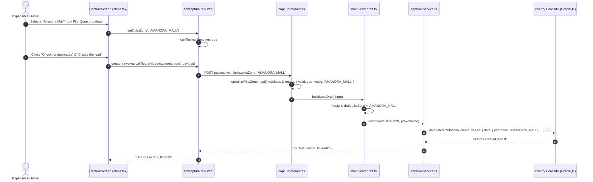

# Task 1 Implementation — Pune Pilot Leads & Vibe Filters

**Document Version:** 1.0
**Date:** 2026-10-27
**Branch:** `feature/shlok-pune-pilot-crm`
**Base Commit:** `bd2ab74d86722d4347b8cfb51746d612b78511bd`
**Author:** Shlok Thorat (`shlokthorat-LA-VIVENZIA`)
**Target Package:** `packages/lv-app` (Frontend) & `packages/twenty-apps/internal/lavivenzia-crm` (Backend)

---

## Table of Contents
1. [Purpose and Business Requirement](#1-purpose-and-business-requirement)
2. [Sprint Assignment Requirements](#2-sprint-assignment-requirements)
3. [Scope Implemented](#3-scope-implemented)
4. [Out-of-Scope Items](#4-out-of-scope-items)
5. [Complete Change Inventory](#5-complete-change-inventory)
6. [User-Visible Changes](#6-user-visible-changes)
7. [Zone and Vibe Filter Behavior](#7-zone-and-vibe-filter-behavior)
8. [Pilot Zone Capture and Validation](#8-pilot-zone-capture-and-validation)
9. [URL Parameters and Filter Composition](#9-url-parameters-and-filter-composition)
10. [Frontend-to-Backend Data Flow](#10-frontend-to-backend-data-flow)
11. [GraphQL Query and Fallback Resilience](#11-graphql-query-and-fallback-resilience)
12. [Accessibility and Responsive Layout](#12-accessibility-and-responsive-layout)
13. [Limitations and Outstanding Dependencies](#13-limitations-and-outstanding-dependencies)

---

## 1. Purpose and Business Requirement

La Vivenzia is conducting an operational pilot in Pune, India, onboarding premium hospitality, nightlife, dining, and co-working venues. Experience Hunters and Lead Coordinators require:
1. Fast geographic filtering across four target pilot hubs in Eastern Pune: **Amanora Mall**, **Seasons Mall**, **Magarpatta City**, and **Hadapsar**.
2. Experiential taxonomy filtering across five curated pilot vibes: **Gaming & Arcade**, **Brewery & Nightlife**, **Work Cafe**, **Luxury Spa**, and **Fine Dining**.
3. Mandatory operational zone tagging at lead capture time to ensure incoming relationships are routed to the appropriate local territory coordinator without data loss.

---

## 2. Sprint Assignment Requirements

The sprint assignment specified:
1. Horizontal zone quick-filter pills in `LeadsScreen.tsx`.
2. Horizontal vibe quick-filter pills in `LeadsScreen.tsx`.
3. A mandatory Pilot Zone dropdown in `CaptureScreen.tsx` when creating a venue lead.
4. Backend schema definitions, contract validation, and persistence wiring for `pilotZone` across the capture pipeline.

---

## 3. Scope Implemented

* **Frontend Domain Modules (`packages/lv-app/src/domain/`):**
  * Canonical Pune pilot zone vocabulary, labels, normalizers, and filter matching logic (`pilot-zones.ts`).
  * Canonical vibe mapping definitions, strict subcategory resolution rules, and taxonomy gap documentation (`vibe-taxonomy.ts`).
* **Frontend Screen Enhancements (`packages/lv-app/src/screens/`):**
  * `LeadsScreen.tsx`: Horizontal `Segmented` pills for Zone and Vibe filtering, multi-filter composition (Zone + Vibe + Search + Saved View + Sorting), URL query parameter synchronization (`?zone=...&vibe=...`), active filter chips in `LvFilterBar`, and dedicated empty state resets.
  * `capture/steps.tsx`: Added required `LvSelect` dropdown under Step 3 ("Where they are") with options for all four pilot zones, field validation indicators, and draft binding.
* **Frontend API Client (`packages/lv-app/src/api/`):**
  * `leads.ts`: Updated `LeadListRow` and `LIST_QUERY` with `pilotZone` and `subcategory`; implemented resilient two-tier query fallback (`FALLBACK_LIST_QUERY`) that gracefully handles pending database metadata synchronization without crashing.
  * `capture.ts`: Integrated `pilotZone` into `CaptureDraft`, `draftPayload`, and gated `canReview` so progression requires a valid selected zone.
* **Backend Taxonomy & Object Definition (`packages/twenty-apps/internal/lavivenzia-crm/`):**
  * Universal identifier constant `LEAD_PILOT_ZONE_FIELD_ID = '9f223515-83d3-5708-8d6d-16b0e39affac'`.
  * `lead-taxonomy.ts`: Added `LEAD_PILOT_ZONES`, `LeadPilotZone`, labels, and `isLeadPilotZone`.
  * Select option generator script (`generate-select-options.mjs`) updated and run to generate deterministic UUIDv5 options in `select-options.generated.ts`.
  * `lead.object.ts`: Registered `pilotZone` field with `FieldType.SELECT`, `isNullable: true`, and select options.
* **Backend Capture & Persistence Pipeline (`packages/twenty-apps/internal/lavivenzia-crm/src/modules/lv-capture/`):**
  * `capture-request.ts`: Implemented `normalizePilotZoneInput` with server-boundary validation, rejecting unsupported values and normalizing labels/casing/whitespace.
  * `capture.types.ts`: Added `pilotZone` to `CaptureInput` and `LeadDraft`.
  * `build-lead-draft.ts`: Mapped `pilotZone` into `LeadDraft`.
  * `capture-service.ts`: Wired `pilotZone` into `leadCreateData` for record mutation.

---

## 4. Out-of-Scope Items

To maintain strict sprint boundaries and avoid unauthorized refactoring, the following items remain **out of scope**:
* **Task 2:** Onboarding workflow widget and SLA tracking.
* **Task 3:** Sandbox importer and bulk visiting-card OCR.
* **Direct Database Migrations:** No execution of `syncApplication(dryRun: false)` or direct SQL table mutations on local databases (must be run during staging/production deployment).
* **Location Field Mutation:** The existing free-form string `location` field remains completely unchanged and is not overwritten by `pilotZone`.

---

## 5. Complete Change Inventory

### Modified Files (13 files)
| Package | File | Purpose |
|---|---|---|
| `lv-app` | `src/screens/LeadsScreen.tsx` | Added zone & vibe filter pills, URL synchronization, active chips, and empty-state resets |
| `lv-app` | `src/screens/capture/steps.tsx` | Added required Pilot Zone dropdown under "Where they are" in Step 3 |
| `lv-app` | `src/api/leads.ts` | Added `pilotZone` & `subcategory` to query, plus resilient fallback handling |
| `lv-app` | `src/api/capture.ts` | Added `pilotZone` to draft, payload, and `canReview` gating |
| `lavivenzia-crm` | `scripts/generate-select-options.mjs` | Configured deterministic generation for `LEAD_PILOT_ZONE_OPTIONS` |
| `lavivenzia-crm` | `src/constants/universal-identifiers.ts` | Declared `LEAD_PILOT_ZONE_FIELD_ID` |
| `lavivenzia-crm` | `src/modules/lv-core/constants/lead-taxonomy.ts` | Defined `LEAD_PILOT_ZONES`, labels, and `isLeadPilotZone` |
| `lavivenzia-crm` | `src/modules/lv-core/constants/select-options.generated.ts` | Generated select options with deterministic UUIDv5 IDs |
| `lavivenzia-crm` | `src/modules/lv-core/objects/lead.object.ts` | Registered `pilotZone` field with `FieldType.SELECT` on `lvLead` |
| `lavivenzia-crm` | `src/modules/lv-capture/types/capture.types.ts` | Added `pilotZone` to `CaptureInput` and `LeadDraft` |
| `lavivenzia-crm` | `src/modules/lv-capture/services/capture-request.ts` | Server-boundary validation and whitespace/case normalization |
| `lavivenzia-crm` | `src/modules/lv-capture/utils/build-lead-draft.ts` | Mapped `pilotZone` into `LeadDraft` |
| `lavivenzia-crm` | `src/modules/lv-capture/services/capture-service.ts` | Passed `pilotZone` into `leadCreateData` payload |

### New Files Created (7 files)
| Package | File | Purpose |
|---|---|---|
| `lv-app` | `src/domain/pilot-zones.ts` | Canonical Pune zones vocabulary, normalizers, and match functions |
| `lv-app` | `src/domain/vibe-taxonomy.ts` | Canonical vibe taxonomy mapping, strict match functions, and gap notes |
| `lv-app` | `src/domain/__tests__/pilot-zones.test.ts` | 10 unit tests for zone vocabulary and matching |
| `lv-app` | `src/domain/__tests__/vibe-taxonomy.test.ts` | 13 unit tests for vibe mapping, negative cases, and gap documentation |
| `lv-app` | `src/screens/__tests__/leads-screen-filters.test.ts` | 13 unit tests for filter composition, URL sync, and fallback query logic |
| `lv-app` | `src/api/__tests__/capture-zone.test.ts` | 9 unit tests for capture lifecycle, draft payload, and validation |
| `lavivenzia-crm` | `src/modules/lv-capture/__tests__/pilot-zone-capture.test.ts` | 8 backend unit tests for request parsing, normalization, and payload mapping |

### Untracked Files Preserved Untouched
* `setup_lavivenzia_app.js` — Local untracked script preserved byte-for-byte; excluded from staging and commits.

---

## 6. User-Visible Changes

### My Leads Screen (`/leads`)
* **Pilot Zone Pills:** Positioned horizontally directly beneath saved views. Exact options: `All`, `Amanora Mall`, `Seasons Mall`, `Magarpatta City`, `Hadapsar`.
* **Vibe Quick-Filter Pills:** Positioned horizontally beneath the Zone pills. Exact options: `All`, `Gaming & Arcade`, `Brewery & Nightlife`, `Work Cafe`, `Luxury Spa`, `Fine Dining`.
* **Active Filter Chips:** Active non-default filters appear as removable chips in the `LvFilterBar` header with "Clear all" capability.
* **Empty State:** If a filter combination returns zero matches, a dedicated message ("No leads match the selected filters") appears with a one-click "Reset zone & vibe" button.

### Capture Screen (`/capture`)
* Under Step 3 (Review Step, section "Where they are"), a mandatory **Pilot zone \*** dropdown is rendered.
* Features placeholder: `"Select a Pune pilot zone…"`.
* The "Check for duplicates" button is disabled until a valid zone is selected.
* An inline validation message `"Pilot zone is required"` appears if unselected.

---

## 7. Zone and Vibe Filter Behavior

### Pune Pilot Zone Matching (`matchesPilotZone`)
* `'all'` matches every lead record, including legacy records with `pilotZone: null`.
* Selecting a specific zone matches only records whose `pilotZone` exactly matches that canonical code (e.g. `AMANORA_MALL`).
* Null, undefined, or empty values do not match any specific zone filter.

### Vibe Taxonomy Matching (`matchesVibe`)
* `'all'` matches every record.
* Matches only explicit, recognized subcategories:
  * `brewery_nightlife` → `BAR_LOUNGE`, `BREWERY`, `NIGHTLIFE`.
  * `fine_dining` → `FINE_DINING`. Generic `RESTAURANT` is intentionally excluded to avoid false positives.
  * `luxury_spa` → `LUXURY_SPA`, `SPA`. Generic `WELLNESS_PROVIDER` is intentionally excluded.
  * `work_cafe` → `WORK_CAFE`. Generic `CAFE` is intentionally excluded.
  * `gaming_arcade` → `GAMING_ARCADE`, `GAMING`, `ARCADE`.
* Venue names, addresses, descriptions, or free text are **never** used to infer vibes.

---

## 8. Pilot Zone Capture and Validation

1. **Frontend Validation:** `canReview` requires `draft.name.trim().length > 1` AND `isPilotZone(draft.pilotZone)`.
2. **Draft State Preservation:** The selected zone is held in React state and preserved across step navigation (e.g., clicking "Back a step" from duplicate check).
3. **Payload Construction:** Sent via `draftPayload` to both `/lead/capture/preflight` and `/lead/capture/create`.
4. **Server Boundary Validation:** `readCaptureInput` executes `normalizePilotZoneInput(fields.pilotZone)`.
   * Accepts canonical keys (`AMANORA_MALL`) and human labels (`Amanora Mall`), trimming leading/trailing whitespace and matching case-insensitively.
   * Rejects unsupported strings with HTTP error: `"pilotZone must be one of: AMANORA_MALL, SEASONS_MALL, MAGARPATTA_CITY, HADAPSAR."`
   * Accepts `null` or omitted values for non-pilot legacy API callers.

---

## 9. URL Parameters and Filter Composition

* URL parameters `?zone=...` and `?vibe=...` synchronize with filter state.
* Selecting `'all'` removes the parameter from the URL, keeping bookmarks and URLs clean (`/leads` instead of `/leads?zone=all&vibe=all`).
* History updates use `{ replace: true }` to avoid polluting the browser history stack.
* Malformed or unknown URL parameters safely fall back to `'all'` without throwing exceptions.
* All filters compose independently using strict AND logic:
  $$\text{Visible Leads} = \text{inView}(\text{view}) \land \text{matchesPilotZone}(\text{zone}) \land \text{matchesVibe}(\text{vibe}) \land \text{matchesSearch}(\text{query})$$

---

## 10. Frontend-to-Backend Data Flow



---

## 11. GraphQL Query and Fallback Resilience

In `packages/lv-app/src/api/leads.ts`:
1. `LIST_QUERY` requests:
   ```graphql
   query LvLeadList($first: Int!) {
     lvLeads(orderBy: { lastInteractionAt: DescNullsLast }, first: $first) {
       edges { node {
         id lvLeadId name organisationName location pilotZone category subcategory status priority
         ...
       } }
     }
   }
   ```
2. When GraphQL responds with `Cannot query field "pilotZone"` (because database metadata sync has not yet occurred on the active instance), `useLeadList` catches the error.
3. The catch block checks `/Cannot query field ["']pilotZone["']/i.test(message)`.
4. If matched, it transparently executes `FALLBACK_LIST_QUERY` (which omits `pilotZone`) and maps each record with `pilotZone: null`.
5. If the error is network-, authentication-, or syntax-related, it throws immediately and presents the error notice to the user, preventing silent error suppression.

---

## 12. Accessibility and Responsive Layout

* All filter pills use the `Segmented` component built on semantic HTML buttons.
* Segmented groups include accessible labels (`aria-label="Pilot zone"` and `aria-label="Vibe"`).
* Interactive items maintain visible focus rings (`outline: 2px solid #1F4D3A`).
* Responsive styling utilizes `theme.space`, `theme.type`, and flex wrapping so filter rows scroll or wrap on 375px mobile viewports without horizontal clipping.

---

## 13. Limitations and Outstanding Dependencies

1. **Metadata Synchronization Pending:**
   The `pilotZone` field is registered in TypeScript code (`lead.object.ts`), but database metadata sync (`syncApplication`) has not been executed on the local database in accordance with audit safety rules.
2. **Staging Persistence Verification:**
   Actual physical persistence in the PostgreSQL `lvLead` table requires running `syncApplication(dryRun: false)` in a designated staging environment.
3. **Taxonomy Gaps:**
   Vibes requiring fine discrimination (e.g. Fine Dining vs Casual Dining, Luxury Spa vs Standard Clinic) require explicit subcategory assignment during lead capture to appear under specific vibe filters.
